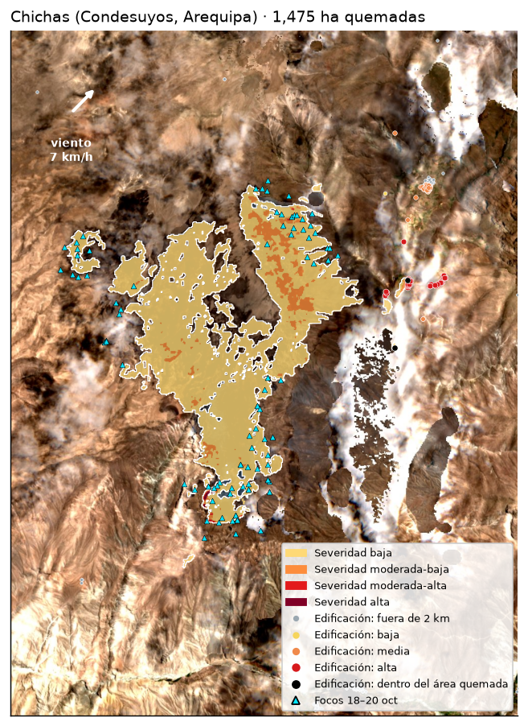
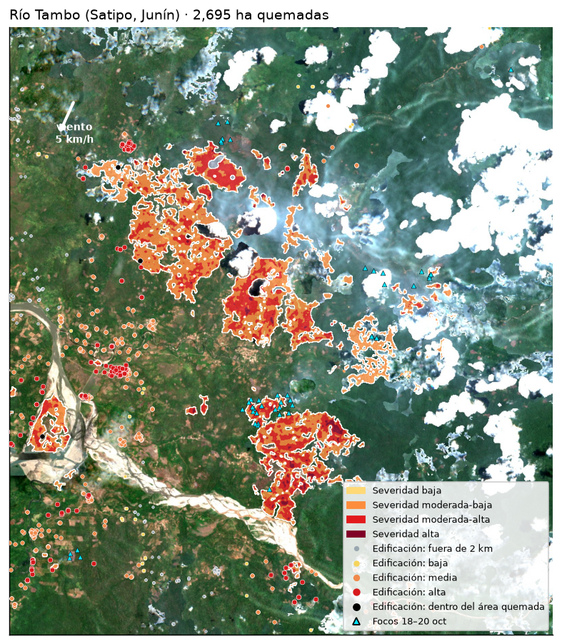
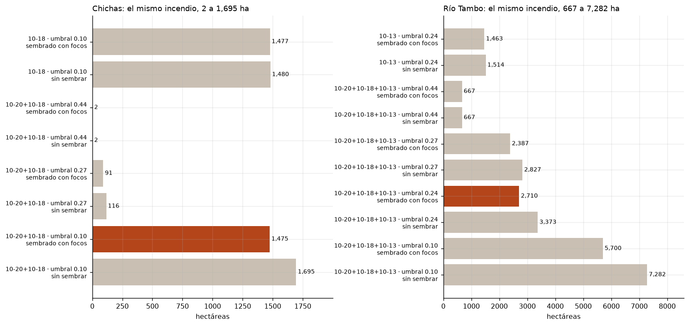
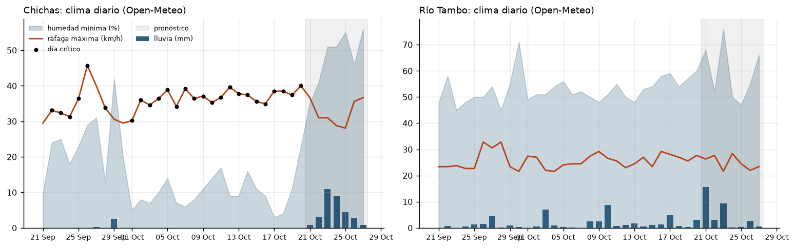

# Incendios en el Perú vistos desde el espacio: Chichas y Río Tambo

**Luis Gabriel Guevara Vega** · Python Intermedio · Diplomatura de QLab · Pontificia Universidad Católica del Perú (PUCP) · datos al **20 de octubre de 2026**

- **Informe interactivo con vista 3D:** [claude.ai/artifact/5zC59rYbPi2SQ47PrArLYL](https://claude.ai/artifact/5zC59rYbPi2SQ47PrArLYL) · copia en GitHub Pages: [luisguevaravega.github.io/incendios-peru](https://luisguevaravega.github.io/incendios-peru/)
- **Diapositivas:** [claude.ai/artifact/PVJG8uQaNE7VpfKT9hgWjy](https://claude.ai/artifact/PVJG8uQaNE7VpfKT9hgWjy)
- **Notebook:** [`notebooks/incendios_chichas_rio_tambo.ipynb`](notebooks/incendios_chichas_rio_tambo.ipynb) · **Streamlit:** `uv run streamlit run app/streamlit_app.py`

## La pregunta

¿Cuánto se quemó en dos de los incendios más grandes de octubre de 2026, qué tipo de vegetación ardió y **qué edificaciones quedan expuestas**? Uno en la puna de Arequipa (**Chichas**, Condesuyos) y otro en la selva central (**Río Tambo**, Satipo, Junín).

Retos A (medir un incendio con dNBR) + C (cruzar con WorldCover) + Google Open Buildings + clima.

## Tres hallazgos

1. **Chichas: 1 475 ha en tres días (16–18 oct), 72 % pastizal y 28 % matorral, entre 3 337 y 4 112 m.** Con el umbral clásico de dNBR 0,27 se habrían reportado solo 91 ha: el 94 % del área ardió con severidad baja, típica del pasto de puna. Un tercio (449 ha) está en el distrito vecino de Toro (La Unión).
2. **Río Tambo: 2 695 ha, 98 % bosque, y sigue activo.** 778 focos VIIRS desde el 28 de septiembre y 48 entre el 18 y el 20 de octubre. Ardió con humedad mínima de 45–70 %: no lo explica el clima sino las quemas.
3. **648 edificaciones de Google Open Buildings a ≤ 1 km del fuego** (587 en Río Tambo y 61 en Chichas). 322 tienen exposición alta (265 + 57) y 6 ya están dentro del área quemada.




## Datos (todos abiertos, sin clave ni pago)

| Dato | Fuente | Fechas | Para qué |
|---|---|---|---|
| Focos de calor VIIRS (S-NPP, NOAA-20, NOAA-21) | INPE Queimadas, CSV diario Sudamérica | 21 sep – 20 oct 2026 (hora de Lima) | dónde arde, semillas del dNBR |
| Validación de focos | NASA FIRMS, CSV «South America 7d» | 15 – 20 oct 2026 | INPE vs FIRMS: +1 % a +5 % |
| Límites distritales | INEI vía [juaneladio/peru-geojson](https://github.com/juaneladio/peru-geojson) | — | focos y hectáreas por distrito |
| Sentinel-2 L2A (B8A, B12, SCL, RGB) | Microsoft Planetary Computer, `sentinel-2-l2a` | Chichas 15 → 20+18 oct; Río Tambo 28 sep → 20+18+13 oct | NBR, dNBR, severidad |
| Cobertura del suelo | ESA WorldCover 2021, `esa-worldcover` | 2021 | qué se quemó; sin combustible |
| Relieve | Copernicus DEM GLO-30, `cop-dem-glo-30` | — | altitud, pendiente, vista 3D |
| Edificaciones | [Google Open Buildings v3](https://sites.research.google/open-buildings/) (celdas S2 917 y 911) | imágenes hasta ~2023 | viviendas expuestas |
| Clima diario y horario | [Open-Meteo](https://open-meteo.com), sin clave | 30 días atrás + 7 de pronóstico | días críticos, viento |

## Método

| Paso | Qué | Dónde |
|---|---|---|
| 1 | Focos VIIRS del Perú, ubicados por polígono distrital; INPE validado con FIRMS | `src/focos.py` |
| 2 | Incendio = focos a ≤ 1 km y ≤ 48 h (componentes conexas) | `src/focos.py` |
| 3 | Nubes medidas **dentro de la zona** con SCL, no las de la escena | `src/sentinel.py` |
| 4 | NBR con desfase de +1000 corregido; compuesto «primera fecha limpia por píxel»; agua (SCL) y suelo sin combustible (WorldCover 60/70/80) excluidos | `src/sentinel.py` |
| 5 | **Umbral = máx(0,10; p95 del dNBR en zonas sin focos a > 3 km)**; mediana 3×3; manchas ≥ 1 ha que toquen un foco ocurrido entre las dos imágenes | `src/sentinel.py` |
| 6 | Cruces en la misma grilla de 20 m: WorldCover, DEM, distritos | `src/cruces.py` |
| 7 | Índice de exposición por edificación (abajo) | `src/cruces.py` |
| 8 | Exportación para README, notebook, Streamlit e informe interactivo 3D | `src/pipeline.py`, `src/figuras.py` |

**Decisiones que cambian el número** (la lección de Curahuasi):

| | Chichas | Río Tambo |
|---|---|---|
| Imagen previa (nubes en la zona) | 15 oct (0 %) | 28 sep (6,2 %) |
| Imagen posterior | 20 oct (12,5 %) → 18 oct (0 %) | 20 oct (46,5 %) → 18 oct (71,4 %) → 13 oct (17,9 %) |
| Zona vista sin nubes después | 100 % | 88,9 % |
| Ruido p95 → umbral | 0,098 → **0,10** | 0,242 → **0,24** |
| Zona (lon/lat) | −73,03 −15,56 −72,93 −15,43 | −73,94 −11,95 −73,78 −11,775 |
| Rango de la sensibilidad | 2 a 1 695 ha | 667 a 7 282 ha |



**Índice de exposición (0–100) de cada edificación.** No predice qué casa se quemará; ordena dónde mirar primero.

| Componente | Puntos | Regla |
|---|---|---|
| Cercanía | 50 | lineal: 50 en el borde del fuego (área quemada + focos del 18–20 oct), 0 a 2 km |
| Viento | 20 | a ±45° de hacia dónde sopla el viento de la tarde (12–18 h) pronosticado del 21 al 23 oct |
| Pendiente | 15 | más alta que el punto de fuego más cercano |
| Combustible | 15 | fracción de vegetación WorldCover en ~100 m |

Alta ≥ 60, media 35–60, baja < 35. Cada edificación trae su Plus Code (`full_plus_code`) para ubicarla en Google Maps: `data/processed/*/edificaciones_expuestas.csv`.



## Limitaciones

- **Un foco de calor no es un incendio.** VIIRS pasa dos veces al día y no ve fuegos chicos, cortos o bajo dosel cerrado.
- **Las nubes esconden el fuego.** En Río Tambo el 11 % de la zona no tiene ninguna observación limpia posterior: el área real puede ser mayor.
- **El umbral es una decisión.** El ruido se midió, pero 0,10 en sierra y 0,24 en selva siguen siendo elecciones; la tabla de sensibilidad muestra cuánto pesan.
- **Open Buildings detecta techos, no hogares**: incluye corrales y depósitos; las imágenes base son de hasta ~2023.
- **WorldCover es de 2021.** El índice de exposición no es un modelo de propagación.
- Una mancha junto al río en Río Tambo tiene focos encima y se mantuvo; puede incluir cambios de orilla.
- Herramienta académica e independiente: no reemplaza los reportes del COEN, INDECI, SERFOR ni SERNANP.

## Cómo reproducir

```bash
uv sync
uv run python src/focos.py            # focos INPE + FIRMS, distritos, incendios (≈ 1 min)
uv run python src/open_buildings.py   # recorta Open Buildings (lee ~1 GB una vez)
uv run python src/pipeline.py         # Sentinel-2, cruces, exposición, datos web (≈ 3 min, CPU)
uv run python src/figuras.py          # figuras del README
uv run streamlit run app/streamlit_app.py
```

Para otro incendio: agrega una entrada en `INCENDIOS` de `src/config.py` (caja, fechas antes/después y celda S2 de Open Buildings).

```
src/          config, focos, sentinel, cruces, open_buildings, pipeline, figuras
notebooks/    notebook explicado paso a paso (con salidas)
app/          dashboard Streamlit
web/          informe interactivo con vista 3D (deck.gl), publicado en Claude
docs/         el mismo informe para GitHub Pages + data/ que lee
data/processed/  resultados: resumen.json, CSV, GeoJSON por incendio
figs/         figuras
```
Datos de terceros con sus licencias: Copernicus Sentinel-2 y DEM (Copernicus), ESA WorldCover (CC BY 4.0), Google Open Buildings (CC BY 4.0 y ODbL), Open-Meteo (CC BY 4.0), INPE Queimadas, NASA FIRMS.
